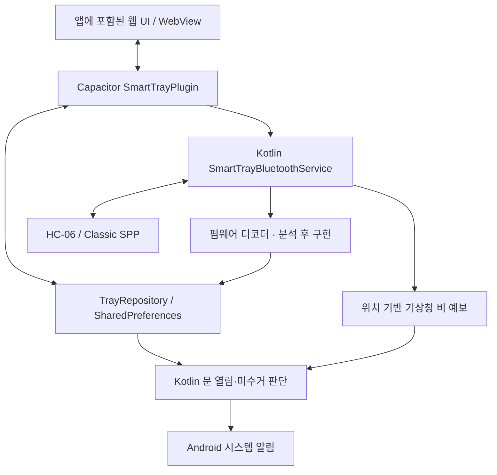

# 아마따

아마따는 현관의 트레이 2칸·접이식 우산 공간 1칸과 Android 앱을 연결해 외출할 때 중요한 소지품을 챙기도록 돕는 IoT 프로젝트입니다.

이름 **아마따**는 소지품을 두고 나온 뒤 하는 “아, 맞다! 놓고 왔지”를 말하는 소리에서 따왔습니다. 말풍선 속 둥근 느낌표와 작은 반짝임으로 떠올림의 순간을 표현합니다. [브랜드 아이콘과 적용 규칙](docs/BRAND.md)을 참고하세요.

## 배경과 목적

지갑, 자동차 키, 이어폰 등을 집에 두고 나오는 문제를 줄이고자 합니다. 현관 근처의 트레이에 소지품을 보관하고, 문이 열릴 때 트레이에 남은 물건을 앱에서 안내하는 것이 목표입니다. 센서는 물건의 종류를 식별하지 않고 각 칸의 존재 여부를 감지합니다. 각 트레이에는 사용자가 별칭을 지정할 수 있습니다.

## 개발 상태와 책임

현재 프로젝트는 **Capacitor 기반 Android 앱 + 공통 HTML/CSS/Vanilla JavaScript UI**입니다. 앱 화면·Kotlin 통신 서비스·로컬 시스템 알림을 구현했으며, 브라우저에서는 가상 장치로 화면과 동작을 체험할 수 있습니다. 구성 요소와 저장 방식은 [앱 구조](#앱-구조-capacitor--kotlin-통신-서비스)에 정리합니다.

**Arduino 센서 디코더와 실제 장치 제어는 펌웨어 규격 확정 전으로 미구현이며, 물리 HC-06·센서·출력 부품 연동은 실기기 검증 대기입니다.** Bluetooth 연결 성공과 센서 데이터 수신 완료를 구분합니다. 아래의 하드웨어 요구사항과 앱 설정 UI를 실제 장치 연동 완료로 해석하지 않습니다.

| 담당 영역 | 책임 및 진행 범위 |
| --- | --- |
| 하드웨어·펌웨어 팀 | Arduino 제작·회로, 센서 측정, Bluetooth 송수신, 공용 LED·건조 팬 제어, 장치 설정 저장 방식 |
| 앱 팀 | 공통 웹 UI, Capacitor Android 앱, Kotlin 통신 서비스·설정 저장·로컬 시스템 알림, 위치 기반 날씨 조회 |

펌웨어 규격은 제작 담당자와 협의하고, 실제 소스와 송수신 예시를 전달받아 앱에 연결합니다.

## 처음 실행과 연결·위치 설정

처음 실행하면 인트로 없이 **연결과 위치 설정** 화면이 바로 열립니다. 이 화면에서 Bluetooth 장치를 검색·연결하고 **위치 허용하고 날씨 확인**으로 Android 위치 권한과 날씨를 함께 설정합니다. 휴대폰 위치가 꺼져 있거나 앱 권한이 차단되어 있으면 해당 시스템 설정을 열 수 있습니다. 복귀하면 상태를 다시 확인하고 준비된 위치로 날씨를 조회합니다.

위치는 선택 사항이며 나중에 설정할 수 있습니다. **설정 마치고 시작하기** 또는 **나중에 설정하기**로 저장한 뒤에는 다음 일반 실행부터 홈으로 바로 이동합니다. 시스템 알림으로 실행하면 해당 알림의 대상 화면이 우선합니다. 이후 **설정 → 연결과 위치 설정**에서 다시 관리할 수 있습니다. 위치 확인 전에는 비 예보 우산 알림을 보내지 않습니다.

## 주요 기능과 트레이 구조

하나의 본체에 총 세 보관 공간이 있습니다. 트레이 2칸은 로드셀·HX711로 물건 유무와 무게를 확인하고, 별도의 접이식 우산 공간 1칸은 적외선 센서로 우산 유무만 확인합니다. 우산 공간에는 무게 측정을 적용하지 않으며, 건조 팬과 살균 LED 설정을 별도로 제공합니다. 남는 본체 내부 공간은 회로 수납용으로 확보해 전자부품과 배선이 외부에 보이지 않도록 제작합니다. 회로 수납부는 앱의 보관 공간으로 집계하지 않습니다.

홈에서는 외출 전 체크를 가장 먼저 보여주며, 첫 줄에 1·2번 트레이를 나란히, 둘째 줄에 두 칸 전체 너비의 우산 공간을 배치합니다. 물건이 남은 트레이 수의 분모는 2입니다. 우산 칸에는 예보 지역(시·군·구)과 오늘 비 오는 시간대를 함께 표시하고, 유효한 예보에 비가 없으면 “현재 시간대 맑음/구름 많음/흐림/눈 · 오늘은 비 예보가 없어요”처럼 안내합니다. 하늘 상태 정보가 없으면 비 예보 유무만 표시하며, 확인 전·조회 중·실패·오래된 예보는 비 없음과 구분합니다. 우산 칸을 누르면 현재 시간대의 예보와 아이콘을 볼 수 있는 우산과 날씨 상세 화면으로 이동합니다.

| 칸 | 초기 별칭 | 앱에서 관리하는 정보 |
| --- | --- | --- |
| 1 | 1번 트레이 | 물건 유무, 무게, 센서 상태, LED·살균 설정, 알림 |
| 2 | 2번 트레이 | 물건 유무, 무게, 센서 상태, LED·살균 설정, 알림 |
| 3 | 접이식 우산 공간 | 우산 유무(적외선 센서), 건조 팬·살균 LED 설정, 오늘 비 예보에 따른 우산 알림 |

별칭은 사용자가 수정할 수 있습니다. 활동 기록은 “{별칭} 트레이에 물건이 놓였어요” / “{별칭} 트레이에서 물건이 없어졌어요”로 표시합니다. 기록과 알림 모두 이미 ‘트레이’로 끝나는 별칭에는 단어를 중복해서 붙이지 않습니다. 상태는 물건 있음·없음·센서 확인 불가·수신 대기로 구분하며, 연결 해제 및 오래된 데이터는 최신 상태로 표시하지 않습니다.

우산 화면의 **우산 건조**에서 동작 시간을 **0초·15초·30초·1분**으로 설정합니다. 기본값은 0초(팬 사용 안 함)이며, 선택값은 웹 미리보기와 Android 앱에 저장·복원됩니다. 현재는 시간 설정 UI와 저장을 구현했으며, 우산 거치 시 실제 팬 실행·제어 명령·동작 확인은 Arduino 펌웨어 규격 확인 후 연결합니다. 설정 저장을 팬 작동 성공으로 표시하지 않습니다.

같은 화면의 **우산 살균**은 일반 트레이와 같은 순서로 살균 활성화, 우산 거치 시 자동 실행, 문 열림 시 실행, **5초·10초·20초·30초** 동작 시간을 설정합니다. 기본값은 10초·살균 OFF이며, 사용 여부는 살균 활성화 스위치로 조절합니다. 살균을 끄면 자동 실행과 시간 설정을 비활성화하고 진행 중인 가상 살균도 종료합니다. 이전 우산 설정의 0·15·60초는 10초·살균 OFF로 전환하며, 유효한 5·10·20·30초와 기존 스위치는 유지합니다. 팬 시간과 독립적으로 저장합니다. 브라우저에서는 정상·최신 센서가 우산 있음을 나타낼 때 가상 살균을 실행하며, 우산 제거·센서 오류·수신 중단·연결 해제·살균 OFF 시 종료합니다. Android에서는 설정 저장까지 지원하며, 살균 LED 명령·실제 상태 수신은 펌웨어 연동 대기입니다. 우산 알림 조건은 [우산·비 예보와 현관문 열림 유지 알림](#우산비-예보와-현관문-열림-유지-알림)을 따릅니다.

## 하드웨어 구성 계획

| 부품 | 모델 | 수량 | 역할 |
| --- | --- | ---: | --- |
| 메인보드 | Arduino UNO R3 | 1 | 센서·출력 제어 |
| Bluetooth 모듈 | HC-06 | 1 | Bluetooth Classic SPP 기반 Android 통신 |
| 무게 센서 | 4선식 로드셀 1kg급 | 2 | 칸별 물건 감지 |
| ADC | HX711 | 2 | 로드셀 데이터 변환 |
| 적외선 센서 | 모델 미정 | 1 | 접이식 우산 유무 감지 |
| 건조 팬 | 모델 미정 | 1 | 우산 공간 건조, 앱에서 동작 시간 설정 |
| 문 감지 센서 | MC-38 | 1 | 현관문 개폐 감지 |
| 날씨 디스플레이 | 기존 1602 LCD (16열 × 2행) | 1 | 사용자 정의 도트 아이콘과 영어·숫자로 날씨·비 예보 시간대 표시. 부품 추가·교체 없음 |
| 공간별 공용 RGB LED | WS2812B(계획) | 3개(1·2번 트레이와 3번 우산 공간에 각각 1개) | 일반 점등으로 미수거 물건을 알리고, 동일한 LED를 보라색으로 켜 살균 기능 표시. [공유 제어 규칙](#led-및-살균) 참고 |
| 기타 | 전원·저항·배선·트레이 | 필요 수량 | 본체 제작 |

LED를 포함한 부품의 최종 모델·배선·핀 배치는 제작 담당자가 확정해야 합니다.

## Arduino 디스플레이 날씨 표시

**구현 예정:** Arduino UNO + HC-06 + **기존 1602 LCD**를 사용합니다. 디스플레이 추가·교체 없이 왼쪽 2칸 × 2줄에 큰 도트 아이콘(해·구름·비·눈), 오른쪽 첫 줄에 영어 날씨 이름, 둘째 줄에 비 예보 시간대 또는 안내 문구를 표시합니다. 한글 표시 대신 사용자 정의 문자 4개를 조합하고 날씨가 바뀌면 패턴을 교체합니다.

표시 예시는 `RAIN / 14:00-18:00`, 눈만 올 때 `SNOW / NO RAIN`, 비·눈 예보가 모두 없을 때 `SUNNY 또는 CLOUDY / NO RAIN/SNOW`입니다. 시간대는 비에 대해서만 표시하며 눈 시간대는 계산·표시하지 않습니다. 미수신·실패·만료는 `NO DATA` 등으로 구분합니다.

날씨 조회·해석은 휴대폰 앱에서 수행하고, 결과를 HC-06 Bluetooth Classic SPP로 Arduino에 전달해 표시합니다. 현재 앱의 시간별 날씨·비 구간 계산은 구현되어 있지만 **LCD용 전송 규격과 Arduino 표시 기능은 연동 대기**입니다. 현재 날씨와 이후 예보의 우선순위, 여러 비 구간 순환, 갱신·연결 유실 시 유지 시간은 협의해야 합니다.

확정 요구사항·현재 구현·추가 개발·미정 사항, 16칸 배치 검증과 데이터 제안은 [인수인계서의 1602 LCD 날씨 표시](docs/ARDUINO_HANDOVER.md#6-1602-lcd-날씨-표시)에 모아 관리합니다.

## HC-06 Bluetooth Classic 통신

실제 사용 모듈은 **HC-06**입니다. 일반적인 HC-06은 **Bluetooth 2.0 + EDR의 Bluetooth Classic SPP(Serial Port Profile)** 모듈이며 BLE를 지원하지 않습니다. [HC-06 제조사 데이터시트](https://www.olimex.com/Products/Components/RF/BLUETOOTH-SERIAL-HC-06/resources/hc06.pdf)

앱은 Classic 검색·페어링 목록·시스템 페어링·RFCOMM 소켓 연결/수신·재연결을 구현했습니다. 검색과 페어링 목록에는 앞뒤 공백을 제거한 이름이 **`HC-06` 또는 `AMATTA`와 대소문자까지 정확히 일치하는 기기만** 표시합니다. 제작 시 Bluetooth 이름을 이 기준에 맞춥니다. 같은 이름의 기기는 주소로 구분하며 LE 전용 장치는 제외합니다. [Android Classic 연결 방식](https://developer.android.com/develop/connectivity/bluetooth/connect-bluetooth-devices)

**프로토콜 미확정 — 아래는 앱 측 연동 요구사항이며 실제 펌웨어 지원을 확인해야 합니다.**

| 방향 | 협의할 정보와 동작 |
| --- | --- |
| Arduino → 앱 | 문 상태, 트레이 2칸의 물건 유무·무게·센서 상태, 우산 공간의 적외선 센서 상태·우산 유무, 세 공간의 공유 LED·팬의 실제 동작 상태, 장치·센서 오류 |
| 앱 → Arduino | 각 공간의 LED·살균 설정에 따른 공유 LED 제어, 팬 동작 시간 설정, 상태 조회, [LCD용 날씨 정보](#arduino-디스플레이-날씨-표시) 전송 |

로드셀 무게는 Arduino에서 컵 무게를 차감한 값을 전송하도록 구성합니다. 앱은 수신한 무게를 표시하며, 컵 무게를 다시 빼거나 영점 보정 명령을 보내지 않습니다. 실제 계산과 출력 필드·단위는 펌웨어에서 확인해야 합니다.

핀 배치, HC-06 PIN·UART 속도, 메시지 인코딩·경계·필드·주기, 명령·응답·오류·완료 통지, 설정 저장과 재부팅 복원 규칙을 합의해야 합니다. 공유 LED의 동시 요청 처리와 팬 시작·정지 조건도 이때 확정합니다. 센서 패킷이나 제어 명령을 임의로 정의하지 않습니다.

현재 `PendingFirmwareProtocol.feed(chunk)`는 분할·병합 수신을 처리할 디코더의 교체 지점이며 값을 생성하지 않습니다. 표준 SPP UUID는 연결용, `DeviceReading`은 앱 내부 센서 타입으로 둘 다 센서 패킷 규격이 아닙니다. 실제 펌웨어의 초기화·송수신·명령 처리·지원 설정을 확인한 뒤 디코더와 쓰기 명령을 연결합니다. [분석·검증 체크리스트](docs/HC06_INTEGRATION_NOTES.md)를 참조하세요.

## Android 앱과 시스템 알림 (푸시 메시지 형태)

Android 앱에서는 사용자가 앱을 보고 있지 않아도 **휴대폰 알림창·잠금화면에 푸시 메시지 형태의 시스템 알림**으로 외출 안내를 받도록 구성합니다. 흐름은 **센서 감지 → Kotlin 통신 서비스 수신 → 설정·상태 확인 → Android 로컬 시스템 알림**이며, 별도 서버나 Firebase Cloud Messaging을 사용하지 않습니다. 판단은 WebView 타이머가 아닌 Kotlin에서 수행합니다. 센서 디코더를 연결하기 전에는 실제 문 열림에 따른 알림을 발생시키지 않습니다.

미수거 알림은 유효한 닫힘→열림 이벤트에서 알림이 켜진 트레이에 남은 물건을 한 번의 안내로 묶습니다. 최초 연결·재연결 시 처음 받은 문 상태는 기준값으로 사용합니다. 물건이 없으면 미수거 알림을 만들지 않으며, 연결 해제·오래된 데이터·센서 오류·수신 대기 값으로 물건이 있다고 단정하지 않습니다. 우산 및 문 열림 유지 알림의 조건은 다음 절에서 별도로 정의합니다.

예시: **“잠깐, 두고 간 물건이 있어요” / “차키 트레이에 물건이 남아있어요. 외출 전에 확인해주세요.”** 알림 본문이나 “트레이 확인”을 누르면 대상이 한 칸일 때 해당 트레이 상세로, 여러 칸일 때 트레이 목록으로 이동합니다. 문 열림 안내는 홈으로, 우산 안내는 우산과 날씨 화면으로 이동합니다.

**알림 미리보기:** Android 앱에서는 실제 운영체제 알림을 생성합니다. 브라우저에서는 앱 아이콘·이름·시간·제목·내용·트레이 확인 버튼이 있는 HTML 카드와 상단 배너로 재현하며, 실제 시스템 권한을 요청하거나 알림을 전송하지 않습니다.

**권한과 표시:** 연결 유지용·외출 안내용 알림 채널을 사용합니다. 기기 연결 단계에서는 Bluetooth 권한만 요청하고, 연결 완료 후 외출 알림의 필요성을 안내한 뒤 사용자가 허용 버튼을 누르면 Android 13+의 `POST_NOTIFICATIONS` 권한을 요청합니다. 알림을 거부하거나 차단하면 홈·연결 완료·알림 설정 화면에서 기능 제한과 재허용 경로를 표시합니다. 연결과 화면 확인은 유지하며, 재요청 불가 또는 외출 안내 채널 차단 시에는 사용자가 버튼을 눌러 휴대폰 알림 설정으로 이동합니다. 설정 복귀 후 허용 상태를 다시 확인합니다. 잠금화면·상단 팝업의 노출은 사용자 설정, 채널 중요도와 운영체제 정책을 따릅니다. [Android 알림 안내](https://developer.android.com/develop/ui/compose/notifications), [알림 권한 안내](https://developer.android.com/develop/ui/compose/notifications/notification-permission)

## 우산·비 예보와 현관문 열림 유지 알림

- **우산 알림:** 닫힌 문이 열릴 때, 정상·최신 적외선 센서가 우산 보관 중을 나타내고 **오늘 남은 시간에 비 예보가 있는 경우에만** 시스템 알림을 보냅니다. 비 오는 시간대를 합쳐 “오늘 10:00~12:00, 16:00~17:00 비 예보가 있어요. 우산을 챙겨 주세요.”처럼 표시합니다. 비 예보 없음·우산 없음·센서 오류·오래된 예보에는 보내지 않습니다. **우산을 넣거나 꺼냈다는 알림은 보내지 않습니다.** 같은 문 열림에서 중복 발송하지 않습니다. 알림 화면 이동은 위 시스템 알림 절의 규칙을 따릅니다.
- **현관문 열림 유지:** `설정 → 알림 설정 → 문 열림 판단 시간`에서 **10~300초** 정수로 입력한 뒤 **저장** 버튼으로 적용합니다. 입력 중인 값은 상태 갱신이나 다른 설정 저장으로 확정되지 않습니다. 기본값은 **30초**이며, 이전에 저장한 10초 미만 설정은 10초로, 300초 초과 설정은 300초로 보정하고 다른 설정은 보존합니다. 유효한 열림 신호를 받은 시점부터 N초 안에 닫힘이 확인되지 않으면 한 번 알립니다. **거리 이탈·EOF·통신 끊김·센서 수신 지연에도 대기를 유지**하며, 재연결이나 시간 변경으로 시작 시각을 초기화하지 않습니다. 최신 센서가 계속 열림이면 “현관문이 계속 열려 있어요”, 연결/수신이 끊겨 닫힘을 확인할 수 없으면 “현관문이 닫혔는지 확인해 주세요”라고 안내합니다. 연결 끊김만으로 외출이나 현재 문 열림을 확정하지 않습니다. 열림 신호를 받은 적이 없으면 이 알림도 시작하지 않습니다.
  - 유효한 닫힘 수신은 대기를 취소합니다. 사용자 연결 해제·서비스 중지는 감시를 종료하고, 전체 알림 또는 문 열림 유지 알림 OFF 중에는 보내지 않습니다. 같은 열림에서는 재연결 뒤에도 중복 발송하지 않습니다.
  - 실제 앱은 Kotlin 서비스의 단조 시계와 제한된 WakeLock을 사용하며 WebView 타이머에 의존하지 않습니다. Bluetooth 꺼짐 등으로 자동 재연결을 종료하더라도 이미 시작한 문 확인은 서비스가 실행 가능한 동안 남은 시간까지만 유지합니다. 강제 중지·권한 해제로 인한 프로세스 종료·제조사 절전 제한에서 발송을 보장하지 않습니다. 대기 중인 문 이벤트는 메모리 상태이며 프로세스 종료/재부팅 뒤 복원하지 않습니다. 펌웨어 디코더와 실제 문 센서 연동은 아직 검증 대기입니다.
- **날씨와 위치:** `연결과 위치 설정 → 위치 허용하고 날씨 확인` 또는 `우산과 날씨 → 예보 보기`에서 대략적 위치 권한을 요청합니다. 대략적인 위치를 약 5km 예보 격자(`nx`, `ny`)로 변환해 [기상청 단기예보조회](https://apihub.kma.go.kr/apiList.do?seqApi=10)의 시간대별 강수형태(`PTY`)를 조회합니다. API에 위도·경도 원본을 보내지 않습니다. 위치 권한을 허용하면 홈 버튼을 누를 때(이미 홈인 경우 포함), 홈 화면에 진입할 때, 홈을 보고 앱으로 복귀할 때 현재 위치 또는 유효 시간 내 최근 위치를 확인해 예보를 새로 조회합니다. 진행 중인 조회는 하나로 합치며, 홈 자동 갱신에서는 권한 창을 반복해서 열지 않습니다. 백그라운드에서는 마지막 확인 위치를 사용해 예보를 갱신하며 위치를 계속 추적하지 않습니다. 마지막 확인 좌표는 휴대폰에 저장하며, 위치 제공자 선택과 최근 위치의 유효 시간은 기상청 API 연동 문서에서 관리합니다.
- **우산 알림용 예보 처리:** 한국 시간의 오늘 남은 시간만 사용합니다. 비·비/눈·소나기(`PTY` 1·2·4)를 대상으로, 예보 시각 직전 한 시간 구간을 병합해 표시합니다. 눈만 오는 예보는 제외합니다. 1시간이 지났거나 자정을 넘긴 예보·권한 거부·위치 확인 실패·네트워크 실패·누락된 예보를 “비 없음”으로 취급하지 않습니다. 조회 실패 안내를 표시하고 확인되지 않은 예보로 우산 알림을 보내지 않습니다. 현재 문 열림이 유지되는 동안 조회가 완료되면 조건을 다시 확인합니다.

화면에 기상청 출처를 표시합니다. 인증키는 Git에서 제외한 Android 로컬 설정에서 읽으며 웹 파일에는 넣지 않습니다. 다른 개발 환경의 키 설정과 예보 규칙은 [기상청 API 연동 문서](docs/WEATHER_API.md)를 참조하세요. 실제 적외선·문 센서에서 이 판단까지 이어지는 통신은 펌웨어 디코더 확정 후 검증합니다.

## LED 및 살균

**1·2번 트레이와 3번 우산 공간 모두 공간마다 LED 부품 1개씩, 총 3개를 사용합니다. 각 공간의 일반 LED 점등과 살균 기능 표시는 같은 부품을 공유합니다.** 하나의 LED에 대한 점등·소등·색상 제어로 두 역할을 수행합니다. 우산 살균의 설정과 동작은 위 [트레이 구조](#주요-기능과-트레이-구조) 절에 별도로 정리합니다.

일반 LED는 **외출하려고 현관문을 열었을 때 해당 공간 안에 물건이 남아 있음을 시각적으로 알리기 위해** 켭니다. 문 열림과 해당 공간의 미수거 상태를 함께 판단해 물건이 남은 공간의 LED를 켜며, 1·2번 트레이는 무게 센서, 3번 우산 공간은 적외선 센서로 물건 유무를 확인합니다.

| 기능 | 각 공간의 공용 LED 역할 |
| --- | --- |
| 일반 LED | 문 열림 시 남아 있는 물건을 시각적으로 알림 |
| 살균 | **동일한 LED를 보라색으로 점등**하여 살균 기능 표시 |

**메이커톤 예산 내에서 자외선(UV) 모듈을 확보하지 못해 이번 시제품에는 UV 모듈이 없으며, 보라색 LED로 살균 동작을 시연합니다.** 앱에서 두 기능을 구분하더라도 Arduino에서는 공간별 하나의 물리 LED 출력을 제어해야 합니다.

공유 LED 구성과 일반 점등의 목적·시작 조건은 위와 같으며, 펌웨어 개발 전에 다음 세부 사항을 협의해야 합니다.

- 일반 점등과 살균 표시가 동시에 요청될 때의 우선순위와 색상 전환 방식.
- 일반 점등 색상·밝기 및 살균 표시의 보라색 값, 물건 수거·문 닫힘·시간 경과에 따른 일반 점등 종료 조건, 살균 시간 종료·중지 시 소등할지 일반 점등으로 복귀할지.
- 두 기능의 활성화 설정과 실제 LED 출력 상태를 앱·Arduino 사이에서 동기화하는 방법.

현재 앱에는 설정 UI·휴대폰 저장·브라우저 가상 동작이 구현되어 있습니다. 1·2번 트레이 UI의 기존 “물건을 놓으면 켜기” 옵션과 가상 동작은 위 일반 점등 조건에 맞춘 정리가 필요하며, 3번 공간의 일반 LED 제어도 연결해야 합니다. 공유 LED를 제어하는 실제 명령과 응답은 [통신 규격 협의](#hc-06-bluetooth-classic-통신) 후 연결합니다.

## 앱 구조: Capacitor + Kotlin 통신 서비스



- **화면:** `index.html`, `css/`, `js/`가 수정 대상입니다. `npm run build`가 `www/`를 만들고 `npm run sync:android`가 Android assets에 반영합니다. 생성된 `www/`나 Android assets를 직접 수정하지 않습니다.
- **앱 패키지:** 웹 파일은 APK 안에 포함됩니다. 외부 웹 호스팅이나 Node/Python 서버가 필요하지 않습니다. 배포 설정에 개발용 `server.url`을 넣지 않습니다. [Capacitor 개발 흐름](https://capacitorjs.com/docs/basics/workflow)
- **Android 브리지:** `native/bridge.js`와 `js/native-transport.js`가 UI를 `SmartTrayPlugin.kt`에 연결합니다. 브리지는 요청·상태 전달을 담당하며 Bluetooth 연결 수명은 소유하지 않습니다.
- **통신(현재 구현):** `SmartTrayBluetoothService.kt`가 Classic 검색·페어링·소켓 소유·복구를 담당하며 `RfcommSession.kt`가 메인 스레드 밖에서 연결·읽기·쓰기를 처리합니다. 표준 SPP UUID로 연결하며, 실제 소켓 성공과 센서 데이터 수신을 구분합니다.
- **설정·알림 판단:** Android는 `TrayRepository`와 SharedPreferences가 설정의 기준이며 웹 저장소는 표시용 캐시입니다. 브라우저·체험 모드는 별도 localStorage에 설정을 저장합니다. Kotlin 알림 정책은 위의 시스템 알림·우산·문 열림 유지 규칙을 적용합니다.
- **활동 기록:** 위와 같은 플랫폼별 저장소에 최신 200개를 저장·복원하고, 한도를 넘으면 가장 오래된 기록부터 제거합니다. 기록 → 알림도 저장 대상입니다. 알림함 목록·읽음 상태와 센서 실시간 상태는 세션 한정이며, 이전 센서값을 새 실행의 실시간 상태로 복원하지 않습니다. 브라우저 저장이 차단되면 설정·기록은 해당 세션 동안만 유지합니다.
- **브라우저/체험 모드:** 기존 Mock transport를 사용합니다. Android에서 체험 모드로 바꾸면 실제 Bluetooth 연결을 먼저 해제합니다. 체험 모드의 변경을 실제 장치 설정으로 저장하지 않습니다.

### 앱 화면을 닫아도 통신을 유지하는 방식

**앱 화면의 백그라운드 상태와 통신 서비스의 포그라운드 상태는 동시에 가능합니다.** 앱에서 연결을 시작한 뒤 홈으로 나가거나 다른 앱을 사용하고 화면을 꺼도, Kotlin 서비스가 RFCOMM 소켓과 수신 루프를 유지하도록 구성합니다.

| 구성 요소 | 역할과 실행 상태 |
| --- | --- |
| Capacitor 웹 UI / Activity | 상태 확인·설정 화면. 계속 화면에 띄워 둘 필요 없음 |
| Kotlin 통신 서비스 | `connectedDevice` 포그라운드 서비스로 Bluetooth 연결·수신 유지. 연결 유지용 알림으로 실행 사실 안내 |

필요한 Bluetooth·서비스 권한을 받은 뒤 사용자 연결 동작으로 서비스를 시작합니다. 현재 Manifest는 `android:stopWithTask="false"`로 최근 앱 목록의 화면 제거만으로 서비스를 자동 중지하지 않도록 설정합니다. [포그라운드 서비스](https://developer.android.com/develop/background-work/services/fgs), [연결 장치 서비스 유형](https://developer.android.com/develop/background-work/services/fgs/service-types#connected-device)

현재 Classic 구현은 연결 실패/단절 시 **2·4·8·16초 대기 후 재시도하고, 이후에는 매 실패 후 30초를 기다려 횟수 제한 없이 재시도**합니다. 각 연결 시도는 최대 20초이며 이 시간은 대기 간격에 포함되지 않습니다. 연결에 성공하면 대기 간격을 초기화합니다. `START_STICKY` 재생성에서는 저장된 선택 주소와 재시도 횟수를 확인해 복구를 시도합니다. 앱/연결 유지 알림에서 연결 해제를 선택하면 소켓·예약 작업·저장된 연결 의도를 정리합니다. OS 재생성이 즉시 또는 무중단 복구를 보장하지는 않습니다. [세부 제한 시간·복구 규칙](docs/HC06_INTEGRATION_NOTES.md#연결-유지복구종료)

**유지의 한계:** 사용자가 앱을 강제 중지하거나 Android의 실행 중인 앱에서 중지를 누르면 센서 수신도 멈춥니다. Bluetooth 꺼짐·권한 해제·장치 전원 꺼짐·통신 거리 이탈 중에는 센서 알림을 보장할 수 없습니다. 재부팅 후 자동 시작은 현재 구현하지 않았습니다. 제조사 배터리 제한을 포함해 화면 꺼짐·앱 전환·최근 앱 제거·서비스 재생성·재연결을 실제 기기에서 검증해야 합니다. [사용자에 의한 앱 중지](https://developer.android.com/develop/background-work/services/fgs/handle-user-stopping)

서비스 구현 위치와 실행 안내는 [Android 개발 안내](docs/ANDROID_DEVELOPMENT.md)를 참조하세요.

## 앱 화면

연결·위치 설정, 홈 대시보드, 트레이 관리, 트레이 상세·LED·살균 설정, 알림 설정, 활동 기록, 장치 관리, 앱 정보, 알림함을 제공합니다. 개발자 시뮬레이션 패널은 일반 앱 화면과 구분합니다. [화면 명세](docs/SCREEN_SPEC.md)와 [앱 구조](docs/APP_ARCHITECTURE.md)에 자세한 동작을 기록합니다.

## 저장소

앱 저장소는 [yjjyjjyjjyjj/smart-tray-app](https://github.com/yjjyjjyjjyjj/smart-tray-app)입니다. 로컬 앱 폴더는 `project/`이며, Git `origin`은 `https://github.com/yjjyjjyjjyjj/smart-tray-app.git`을 사용합니다. 이 README는 저장소 루트에 있으며, 문서의 파일 경로와 실행 명령은 이 디렉터리를 기준으로 합니다.

## 디렉터리

```text
project/                           # Git 저장소 및 Capacitor 앱 프로젝트 루트
├── README.md                      # 전체 프로젝트 안내
├── index.html / css/ / js/         # 공통 웹 UI와 브라우저 목업
├── native/bridge.js               # Capacitor 런타임 진입점
├── scripts/build-web.mjs
├── package.json / package-lock.json
├── capacitor.config.json
├── www/                           # 생성물, Git 제외
├── android/                       # Android Studio 프로젝트, 소스 관리 대상
│   └── app/src/main/java/kr/ac/gachon/smarttray/
│       ├── MainActivity.kt
│       ├── SmartTrayPlugin.kt
│       └── bluetooth/             # Classic SPP 서비스, 저장소, 알림, 펌웨어 인터페이스
├── assets/
├── docs/
└── tests/
```

## Android 빌드와 UI 수정

필요 환경은 Node.js 22 이상, Android Studio 2025.2.1 이상, JDK 21, Android SDK 36입니다. 현재 앱의 최소 SDK는 24, target SDK는 36입니다. Capacitor는 `8.6.0`으로 고정하고 `package-lock.json`을 포함합니다. 앱 ID는 `kr.ac.gachon.smarttray`이며 배포 전에 팀의 최종 ID를 확인합니다.

**화면 방향:** Android는 세로 방향으로 고정합니다. target SDK 36의 대형 화면에도 호환 속성을 적용합니다. Android에서 앱 방향을 강제로 재정의하는 기기 설정이나 향후 target SDK 37의 대형 화면 정책은 별도 제약입니다. [Android 화면 방향 정책](https://developer.android.com/about/versions/16/behavior-changes-16#adaptive-layouts)

```sh
npm ci
npm run sync:android
npm run open:android
```

Android Studio에서 기기/에뮬레이터를 선택해 Run을 실행하거나 다음 명령을 사용합니다.

```sh
npm run android
# APK만 빌드할 때 (JDK 21 및 ANDROID_HOME 설정 필요)
cd android
./gradlew :app:assembleDebug
```

디버그 APK는 `android/app/build/outputs/apk/debug/app-debug.apk`에 생성됩니다. 개발·시연용 빌드이며 정식 배포 서명은 별도입니다.

**UI 수정 흐름:** 원본 HTML/CSS/JS 수정 → 브라우저에서 빠르게 확인 → `npm run sync:android` → Android 실행/빌드. HTML/CSS만 수정해도 설치된 앱에 반영하려면 웹 파일 동기화와 APK 재빌드·재설치가 필요합니다. Kotlin 서비스 코드를 함께 바꿀 필요는 없습니다. 개발 중 Live Reload를 별도로 설정할 수 있지만 배포 기본값으로 사용하지 않습니다.

## 목업 실행

빌드·패키지 설치 없이 `index.html`을 브라우저로 직접 엽니다. 또는 다음 명령으로 로컬 서버를 실행합니다.

```sh
python3 -m http.server 4173 --bind 127.0.0.1
```

브라우저에서 <http://127.0.0.1:4173>에 접속하세요. 최초 실행 시 연결·위치 설정에서 연결을 시뮬레이션하거나 목업 체험을 선택합니다. 설정·기록 보관 방식은 위 [앱 구조](#앱-구조-capacitor--kotlin-통신-서비스)를 따르며, 센서값은 새 세션의 가상 초기값으로 시작합니다.

개발 중에는 설정 화면과 사이드바의 **개발자 시뮬레이션** 버튼을 기본 표시합니다. 브라우저에서는 입력칸 밖에서 **D**를 누르거나 콘솔에서 `SmartTrayApp.openDeveloper()`를 실행해도 문, 트레이·무게, 연결, 오류, LED·살균과 알림을 조작할 수 있습니다. 버튼을 임시로 숨겨 확인하려면 <http://127.0.0.1:4173/?dev=0#settings>로 접속하세요. `?dev=1` 또는 옵션 없는 기본 주소에서는 버튼이 표시됩니다. Android 실제 연결 모드의 설정에 있는 목업 체험 진입 버튼도 같은 표시 규칙을 적용하며, 실제 연결 상태에서는 시뮬레이션 패널을 열지 않습니다. 최종 시연 시 기본 숨김으로 변경할 예정입니다. 이 옵션은 개발 메뉴 표시 여부이며 기능 코드를 빌드에서 제거하는 설정은 아닙니다. A–D 시나리오 버튼은 각 조건을 준비하고 즉시 검증합니다. 웹 로직 검증은 `npm test`로 실행합니다. 브라우저 확인 결과는 `docs/VALIDATION.md`를 참조하세요.

## 남은 장치 연동 및 검증

1. 실제 제작 부품·핀 배치·회로와 Arduino 펌웨어 소스를 공유받아 확인합니다.
2. [통신 요구사항](#hc-06-bluetooth-classic-통신)을 기준으로 송수신 규격과 저장 방식, Arduino의 컵 무게 차감 방식을 확정하고, [공유 LED 동작 규칙](#led-및-살균) 및 우산 팬 시작·정지 조건을 협의합니다.
3. `PendingFirmwareProtocol`을 실제 수신 버퍼·디코더로 교체하고, 지원되는 명령과 성공·실패·완료 응답을 연결합니다.
4. Arduino의 컵 무게 차감·무게 임계값·노이즈 처리와 센서 주기에 맞춘 데이터 신선도, 스냅샷 일관성, 문 열림 중복 방지를 검증합니다.
5. 실기기에서 화면 꺼짐·앱 전환·거리 이탈·서비스 종료·재연결·권한 거부·알림 탭 이동과 공유 LED·팬의 실제 출력 결과를 검증합니다.

Arduino 팀에 전달할 데이터 항목·설정과 제어·LCD 날씨·협의용 메시지 예시·공동 검증 항목은 [Arduino 연동 개발 인수인계서](docs/ARDUINO_HANDOVER.md)에 정리했습니다. 실제 패킷은 펌웨어 팀과 합의 후 확정합니다. 알림별 정확한 문구와 조건은 [푸시 메시지 리스트](docs/푸시메시지_리스트.md)를, 검증 명령과 결과는 [검증 기록](docs/VALIDATION.md)을 참조하세요.
